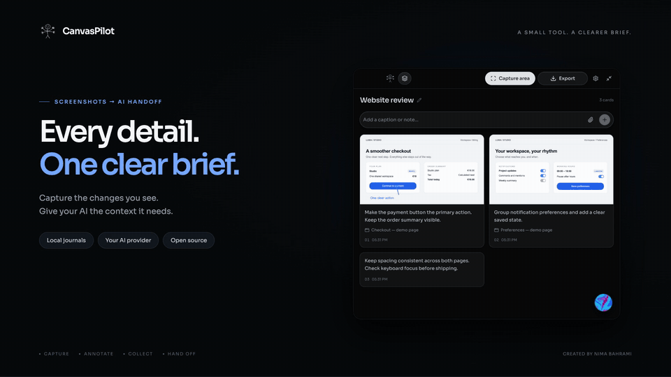

<p align="center">
  
</p>

<h1 align="center">CanvasPilot</h1>

<p align="center"><strong>Turn screenshots into a clear brief for your AI.</strong><br>Capture an area. Mark it up. Add context. Keep it all in one journal.</p>

<p align="center">
  <a href="#quick-start">Quick start</a> ·
  <a href="#the-workflow">Workflow</a> ·
  <a href="#ai-on-your-terms">AI providers</a> ·
  <a href="#privacy">Privacy</a>
</p>

<p align="center">Local journals &nbsp;·&nbsp; Optional AI &nbsp;·&nbsp; MIT licensed</p>

[](https://raw.githubusercontent.com/nimabahrami/canvas-pilot/main/docs/media/canvaspilot-intro.mp4)

<p align="center">
  <a href="https://raw.githubusercontent.com/nimabahrami/canvas-pilot/main/docs/media/canvaspilot-intro.mp4">Watch / download the 25-second film · 1080p</a> &nbsp;·&nbsp;
  <a href="docs/media/canvaspilot-poster.png">Static preview</a>
</p>

<sub>The film uses fictional demo content and app views captured on macOS. Enhancement text is an illustrative example, not a recorded model response.</sub>

## A small tool for a better handoff

A UI review rarely happens in one window. CanvasPilot brings screenshots, annotations, and written requests together, preserving the available window title and capture time for each image. When you're ready, copy one coherent journal into your AI assistant—with paths to the annotated files.

It stays compact, works from the menu bar or system tray, and keeps each session in its own folder. Capture, markup, and export work without an AI account.

| Capability | What it gives you |
| --- | --- |
| **Selected-area capture** | Focus on the relevant part of a window or display. Import and paste images too. |
| **Editable markup** | Arrows, shapes, pen, highlights, and text. Expand the editor for detailed work. |
| **Session journals** | Collect entries across windows and pages without losing their context. |
| **Whole-journal enhancement** | Turn saved entries into tasks, acceptance checks, and a final audit instruction. |
| **Markdown, text, and XML** | Copy or export a brief with screenshot paths instead of embedded image data. |
| **Background shortcuts** | Capture or open the session-copy picker while the main window is hidden. |

## Quick start

Requires **Node.js 22.12+** and npm. macOS also requires **Xcode Command Line Tools** to compile the window-context helper.

```sh
git clone https://github.com/nimabahrami/canvas-pilot.git
cd canvas-pilot
npm ci
npm run dev
```

To run the production renderer in Electron:

```sh
npm run build
npm start
```

<details>
<summary>Browser preview</summary>

Run `npm run dev:web`. The preview stores its library in IndexedDB and exports a ZIP containing the journal and screenshots with relative paths. Native capture, filesystem session folders, global shortcuts, and protected AI keys require the desktop app.

</details>

## The workflow

1. **Capture.** Click **Capture area** to choose a window or display, or use the background shortcut. Drag the area you want.
2. **Clarify.** Add markup and a caption describing the change. Enlarge the editor when you need more room.
3. **Collect.** Keep capturing from other windows or pages in the same session. Click a saved screenshot to edit its annotations.
4. **Enhance, optionally.** Use the bottom-right orb to improve the complete saved journal. Review and edit the proposed text before copying or applying it.
5. **Hand off.** Open **Export**, choose a format, and copy or save the journal for your AI assistant.

Click the session title to rename it. The **Sessions** control opens search, switching, creation, and deletion. Closing the main window keeps CanvasPilot running in the background; quit explicitly from the tray or the platform quit command.

### Keyboard shortcuts

| Action | macOS | Windows / Linux |
| --- | --- | --- |
| Capture an area | Hold **Option**, press **U**, then **I** | Hold **Alt**, press **U**, then **I** |
| Open the session-copy picker | Continue with **P** within 350 ms | Continue with **P** within 350 ms |

These are sequences, not simultaneous multiletter chords. The tray menu also exposes both actions.

## AI on your terms

Choose a provider in **Settings**. Available text models load automatically after you enter an API key; Ollama lists installed local models without a key. Keep automatic selection or choose a model from the searchable picker.

| Provider | Connection |
| --- | --- |
| OpenAI | API key |
| Anthropic | API key |
| Google Gemini | API key |
| NVIDIA | API key |
| OpenAI-compatible API | Custom endpoint and API key |
| Ollama | Local endpoint; no API key required |

Enhancement uses **the whole saved journal**, including captions, screenshot paths, and source metadata. It asks for concrete tasks, observable acceptance checks, and one final audit instruction for the receiving assistant. It does not execute those tasks or certify their completion.

The result is editable, and the original wording can be restored. Unsaved composer text is excluded. See the [enhancer guide](docs/AI-ENHANCER.md) and [shared system prompt](shared/journal.mjs) for the exact behavior.

## Files you can keep

Desktop sessions default to `Documents/CanvasPilot/`. Each session has a stable folder; renaming its title does not change the path.

```text
CanvasPilot/
└── YYYY-MM-DD-session-title-id/
    ├── screenshots/
    │   └── …annotated PNG files
    ├── session.json
    ├── journal.md
    ├── journal.txt
    └── journal.xml
```

All three text formats reference the annotated screenshot files and preserve available source titles and timestamps. Browser URLs are optional context entered by the user. When sharing a journal with someone else, include the referenced images or update the paths so the recipient can access them.

## Privacy

- **Capture and journal locally.** Screenshots, sessions, and drafts stay on your device.
- **Choose when text leaves the device.** Enhancement sends journal text, paths, and source metadata to your selected provider. Screenshot pixels are not uploaded by the enhancer.
- **Keep keys out of journals.** API keys use OS-backed encryption where available; otherwise, they remain in memory for the current launch.
- **Review before sharing.** Journals and captures are not encrypted at rest. Applying redaction permanently flattens the current image and its markup; other annotations remain editable. Imported originals and external backups require separate review.

See [Security](SECURITY.md) for reporting guidance and limitations.

## Desktop builds

| Target | Package | Verification status |
| --- | --- | --- |
| macOS | DMG / ZIP | Development build and app workflows exercised on Apple Silicon |
| Windows | NSIS installer | Build target configured; native verification pending |
| Linux | AppImage / DEB | Build target configured; native verification pending |

Build on the operating system you intend to target:

```sh
npm run package:mac
npm run package:win
npm run package:linux
```

For a locally signed macOS development DMG, run `npm run package:mac:local`. Output is written to `release/`. Quit any running copy before rebuilding, then drag CanvasPilot into Applications and launch the installed copy. Local signing material is generated in the ignored `.local-signing/` directory. Developer ID distribution signing and Apple notarization are not configured.

macOS requires **Screen & System Audio Recording** permission for the installed app. The capture dialog links to System Settings and offers retry/restart. On Linux Wayland, capture may use the system portal and expose limited window metadata.

## Development

```sh
npm run build
npm run check:public
npm audit
```

The publication check catches selected private-file and credential patterns; review staged contents and run a dedicated secret scan before publishing. Personal testing tools, Playwright configuration, internal notes, session data, and signing credentials are excluded from this repository. Only the curated fictional promotional media above is included.

- [Enhancer behavior and review](docs/AI-ENHANCER.md)
- [UI components, adaptations, and font licenses](docs/UI-SOURCES.md)
- [Promotional media details](docs/media/README.md)

## Author and license

Created by **[Nima Bahrami](https://github.com/nimabahrami)**. CanvasPilot is [MIT licensed](LICENSE).

The interface uses components from Kokonut UI, Cult UI, and Interior. Required third-party component and font notices are preserved in [`LICENSES/`](LICENSES/).
